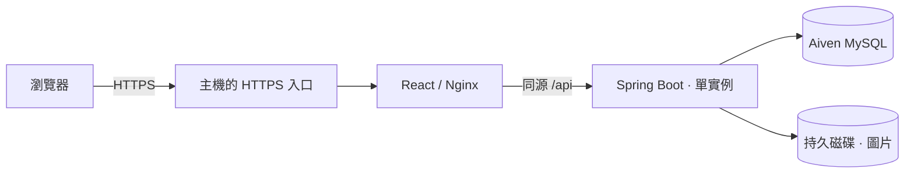

# STAY 部署準備與上線流程

若使用 Vercel + Render Free，請依 [Render／Vercel 部署流程](DEPLOYMENT_RENDER_VERCEL.md) 設定。以下保留 Docker／自有主機的操作方式。

這份設定適用於公開展示版，付款保持 **Stripe Sandbox**。程式已準備成可建置的 Docker 映像；目前沒有建立付費主機、設定網域或發布到外網。

## 建議架構

前端和 API 共用同一個 HTTPS 網址，保留現有 Session Cookie 與 CSRF 流程。



- React production 預設使用 `/api`；開發環境仍使用 `http://localhost:8080/api`。
- `deploy/nginx.conf` 提供 API 代理、SPA 深層網址 fallback 與靜態資源快取。
- Compose 的前端只綁定主機 `127.0.0.1:8088`，後端沒有公開主機埠。對外流量應經過主機或平台的 HTTPS 入口。
- 若使用單台 VM，可參考 `deploy/https-proxy.example.conf`；先取得網域與有效憑證，再替換範例值。已有 HTTPS 入口的平台可沿用平台提供的功能。
- HTTPS 入口必須覆寫外部傳入的 `X-Forwarded-*`，避免把任意用戶端標頭當成可信代理資訊。Spring 使用 forwarded-header 支援辨識 HTTPS。

## 兩個原始碼目錄

範本預期兩個 checkout 並排：

```text
workspace/
  hotel-booking-system/     React，包含 deploy/compose.yaml
  hotel-booking/            Spring Boot
```

兩個專案的最新程式碼都應 commit 並 push。Dockerfile 各自使用自己的專案當作 build context；沒有把本機密鑰、圖片、備份或 node_modules 打進映像。程式碼上 GitHub 不會自動備份資料庫或圖片。

若資料夾名稱不同，可在 `deploy/compose.env` 設定 `STAY_BACKEND_CONTEXT`。Compose 路徑相對於 `deploy/compose.yaml`，不是目前的終端機目錄。

## 後端 production 設定

設定檔在後端 `src/main/resources/application-prod.properties`。本機預設啟用 `local`，只有 `local` profile 才會讀取 `.env.local`；`prod` 不會載入它。

| 設定 | 用途 |
| --- | --- |
| `SPRING_PROFILES_ACTIVE=prod` | 啟用正式部署設定；Docker 映像已預設啟用 |
| `SPRING_DATASOURCE_URL` | 既有 MySQL 資料庫的 JDBC URL，包含 `sslMode=REQUIRED` 或更嚴格的驗證模式 |
| `SPRING_DATASOURCE_USERNAME`、`SPRING_DATASOURCE_PASSWORD` | 只放後端主機的 secret/environment 設定 |
| `APP_FRONTEND_URL` | 對外 HTTPS origin，例如 `https://stay.example.com`，不含結尾斜線、路徑或查詢字串 |
| `APP_CORS_ALLOWED_ORIGINS` | 明確的 HTTPS origins，以逗號分隔，必須包含前端 origin；未設定時沿用前端 origin |
| `STAY_REMEMBER_ME_KEY` | 至少 32 字元的隨機密鑰；保留穩定值，重啟時不要重新產生 |
| `STAY_MEDIA_DIRECTORY` | 已掛載持久磁碟的絕對路徑；範本使用 `/var/lib/stay/hotel-images` |
| `STRIPE_SECRET_KEY`、`STRIPE_WEBHOOK_SECRET` | Sandbox secret key 與公開 webhook endpoint 的 signing secret |
| `STAY_MAIL_PROVIDER` | `brevo` 使用 HTTPS API；`smtp` 保留 Gmail 本機流程 |
| `BREVO_API_KEY`、`BREVO_SENDER_EMAIL`、`BREVO_SENDER_NAME` | Brevo 後端 API key、已驗證寄件地址與顯示名稱 |
| `SPRING_MAIL_USERNAME`、`SPRING_MAIL_PASSWORD` | 只有選擇 `smtp` 時需要的 Gmail 帳號與 App Password |
| `STAY_DB_POOL_SIZE` | 預設 5，先保守使用資料庫連線 |

密鑰應填在主機的 secret 設定，或被 Git 忽略的 `deploy/production.env`。範本故意留白，不會複製你本機的密碼。不要把後端變數填進 `REACT_APP_*`，也不要放進 Docker build arguments。

production 使用 `Secure`、`HttpOnly` Cookie，SameSite 預設 `lax`，remember-me Cookie 也會採用相同策略。正式登入請從 HTTPS 網域開啟；主機 loopback HTTP 埠供反向代理和技術檢查使用。本機開發繼續使用既有 npm dev / Spring local 啟動方式。

前後端若部署在不同網站，可能需要 `SESSION_COOKIE_SAME_SITE=none`、Secure Cookie 和精確 CORS 設定；瀏覽器仍可能限制跨站 Cookie，因此優先保留同源 `/api` 代理。

## 免費主機與 Cloudinary

若後端使用沒有持久磁碟的免費主機，新圖片必須使用 `STAY_MEDIA_PROVIDER=cloudinary`，並在後端設定三個 `CLOUDINARY_*` credentials 和穩定 prefix。酒店、房型、Avatar 都支援。先依 [Cloudinary 說明](CLOUDINARY.md) 搬移既有本機圖片，確認 `legacy=0`，再部署；只設定 keys 不會搬移舊檔。Cloudinary 模式不要求本機持久磁碟。

Render Free 的 SMTP 連接埠限制可改用 Brevo HTTPS API：設定 `STAY_MAIL_PROVIDER=brevo` 和後端 `BREVO_*` secrets，依 [Brevo 說明](BREVO.md) 完成寄件者驗證與收信測試。

## 資料庫與圖片

production 使用 `ddl-auto=validate`，不會自動修改資料表。沿用目前的 Aiven 資料庫即可；若是新資料庫，先把完整 SQL 備份還原到指定資料庫，再啟動後端。缺表或欄位不符時會停止啟動，應修正資料庫結構。未來結構變更要先備份，再套用已檢查的 migration/manual SQL。

`sslMode=REQUIRED` 強制加密，但不提供完整的 CA／主機名稱驗證。若使用 `VERIFY_CA`／`VERIFY_IDENTITY`，也要配置 MySQL JDBC 所需的 CA truststore；依 Aiven 的 TLS 連線說明設定，不要關閉驗證來繞過憑證錯誤。

Compose 將 `stay-media` named volume 掛載到 `/var/lib/stay`，容器重新建立後圖片仍保留。主機搬家、磁碟刪除或執行 `down -v` 仍可能失去資料；持久磁碟要另外備份。

使用既有資料庫時，也要搬入既有圖片。以下命令從前端根目錄執行，圖片來源是並排的後端 checkout：

```powershell
docker compose --env-file deploy/compose.env -f deploy/compose.yaml cp ../hotel-booking/uploads/hotel-images/. backend:/var/lib/stay/hotel-images/
docker compose --env-file deploy/compose.env -f deploy/compose.yaml exec --user root backend chown -R stay:stay /var/lib/stay/hotel-images
```

若部署在另一台主機，先把私人圖片備份傳到該主機，再修改來源路徑。資料庫只存圖片 metadata，不能取代實體圖片檔案。

## 建置與啟動

需要 Docker 與 Compose 2.30 或更新版本。範本使用 `env_file: format: raw`，保留密碼中的 `$` 等字元；`production.env` 的值不要額外加引號。Java `.properties` 的反斜線跳脫規則不同，請逐欄填入實際值，不要直接拿 `.env.local` 當 Compose env file。

1. 只在檔案尚未存在時，複製範本：

   ```powershell
   if (-not (Test-Path deploy/production.env)) { Copy-Item deploy/backend.env.example deploy/production.env }
   if (-not (Test-Path deploy/compose.env)) { Copy-Item deploy/compose.env.example deploy/compose.env }
   ```

2. 填寫 `deploy/production.env`。前端網址範例 `stay.example.com` 要換成實際網域；保留現有 Aiven 資料庫資訊及穩定 remember-me key。若付款暫時關閉，明確設定 `STAY_PAYMENTS_ENABLED=false`。

3. 檢查 Compose 設定，使用 `--quiet` 避免把解析後的密鑰印到終端機：

   ```powershell
   docker compose --env-file deploy/compose.env -f deploy/compose.yaml config --quiet
   ```

4. 建置及啟動：

   ```powershell
   docker compose --env-file deploy/compose.env -f deploy/compose.yaml build --pull
   docker compose --env-file deploy/compose.env -f deploy/compose.yaml up -d
   docker compose --env-file deploy/compose.env -f deploy/compose.yaml ps
   ```

5. 匯入圖片、設定 HTTPS 入口，再從實際 HTTPS 網址測試。

如果主機分開部署兩個服務，可分別使用各專案的 Dockerfile。前端 Nginx 範本的 upstream 名稱是 `backend:8080`，需改成該主機可達的後端位址；也可以由平台提供同源 `/api` 路由。後端使用 `PORT` 環境變數，並依平台支援方式掛載持久磁碟。

## Stripe 與寄信

公開 Stripe Sandbox webhook URL 為：

```text
https://你的網域/api/payments/webhook
```

使用該 endpoint 的 `whsec_...`，不要沿用本機 `stripe listen` 的 signing secret。支援事件：

- `checkout.session.completed`
- `checkout.session.expired`
- `checkout.session.async_payment_succeeded`
- `checkout.session.async_payment_failed`
- `refund.created`
- `refund.updated`
- `refund.failed`

只接受 `sk_test_`／`rk_test_`；這個作品集尚未實作正式收款或 Host 撥款。免費主機可用 Brevo HTTPS API；Gmail SMTP 仍可供本機或支援 SMTP 的主機使用。忘記密碼連結會使用 `APP_FRONTEND_URL` 指向正式前端，詳見 [Brevo 設定](BREVO.md)。

## 驗證與日常操作

`GET /api/health` 會實際執行唯讀 `SELECT 1`；成功回傳 `200 {"status":"UP"}`，資料庫不可用時回傳 `503 {"status":"DOWN"}`，不公開帳密或錯誤細節。前端 `/healthz` 只檢查靜態服務。

上線後執行唯讀檢查：

```powershell
npm run check:deployment -- https://你的網域
```

這會檢查 API／資料庫、SPA 深層網址、缺少的靜態檔、未登入私人 API 及環境檔保護。之後仍要在實際 HTTPS 網域手動測試：

1. 註冊、登入、重新整理、登出，以及 Remember me。
2. 搜尋、房型、日期、收藏與圖片載入／上傳。
3. 一筆 Stripe Sandbox 預訂、付款狀態更新與符合期限的取消／退款。
4. 忘記密碼信能寄達，連結指向正式網址。
5. Host 與 Admin 權限仍有分開，未登入不能讀私人資料。

現有 Session 儲存在單一後端程序中；一般 Session 會在程序重啟後失效。Remember-me 使用穩定 key 可重新驗證，但目前部署維持單實例。若要水平擴展，先加入共享 Session 與共享圖片儲存。

前後端的 GitHub Actions 只執行測試與建置，沒有自動發布、建立雲端資源或使用正式密鑰。部署時請使用可回退的 image tag，並保留 SQL 和圖片備份。

## 本次本機驗證

- 前端 203 項測試及 production Docker 建置通過。
- 後端 146 項測試及 Java 21 Docker 建置通過。
- 隔離 production 容器已驗證 API 代理、資料庫健康檢查、Secure／HttpOnly Cookie、CORS、SPA 路由與圖片在容器重建後保留。
- 開發環境的 `local` profile 也已用唯讀資料庫查詢確認。

尚未建立雲端主機或執行 GitHub Actions；實際網域的 HTTPS、寄信與 Stripe webhook 仍須在部署後完成上面的測試。

## 參考文件

- [Spring Boot：代理與 forwarded headers](https://docs.spring.io/spring-boot/how-to/webserver.html)
- [Docker Compose：服務與 env_file](https://docs.docker.com/reference/compose-file/services/)
- [Docker：Volumes](https://docs.docker.com/engine/storage/volumes/)
- [Aiven：MySQL 備份與還原](https://aiven.io/docs/products/mysql/howto/migrate-database-mysqldump)
